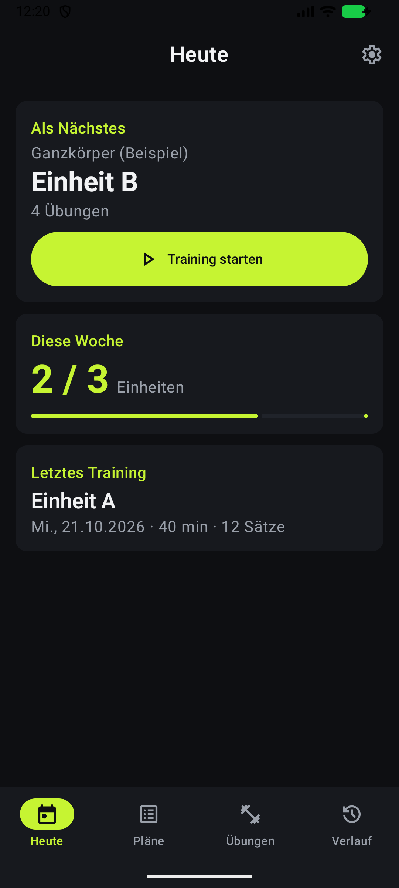
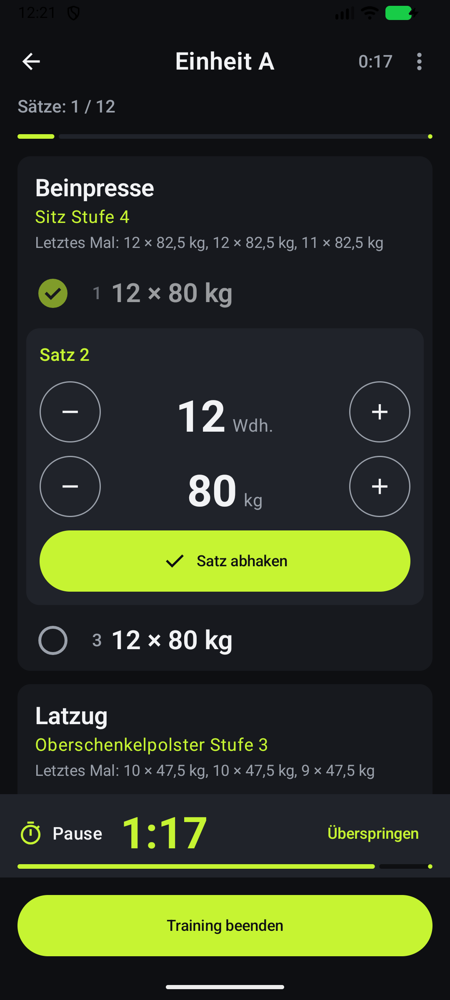
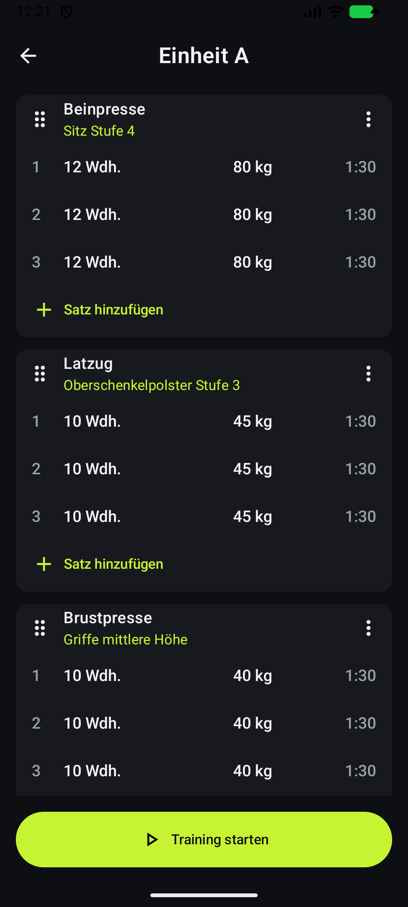
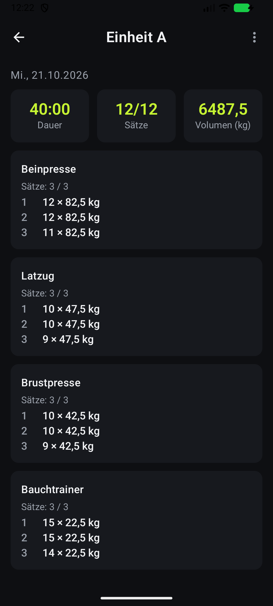

# Forkout

> **Fork it. Lift it.**

Forkout ist eine freie, werbefreie Open-Source-App für Android, mit der du Trainingspläne anlegst und im Gym wie eine Checkliste abarbeitest: Sätze abhaken, Gewichte und Wiederholungen protokollieren, Pausentimer, Verlauf.

*Forkout is a free, ad-free and open-source Android app to build workout plans and tick them off at the gym like a checklist. The app is currently available in German.*

<p>
  
  
  
  
</p>

## Funktionen

- **Pläne** mit Einheiten (A, B, C …), Übungen und Sätzen mit Soll-Wiederholungen, Gewicht und Pause. Alles lässt sich per Drag & Drop sortieren und kopieren.
- **Übungsbibliothek** mit Suche, Filtern nach Typ und Muskelgruppe und Geräte-Einstellungen wie „Sitz Stufe 4“
- **Trainingsmodus** als Checkliste mit großen Zahlen und Steppern, Werten vom letzten Mal und automatischem Pausentimer mit Vibration. Der Bildschirm bleibt dabei an.
- **Heute:** nächste Einheit mit einem Tipp starten, Wochenfortschritt, letztes Training
- **Verlauf** aller Trainings und pro Übung
- **Export und Import** aller Daten als offene JSON-Datei ([Format](docs/BACKUP_FORMAT.md))
- Dunkles Design, optional echtes AMOLED-Schwarz

## Privatsphäre

Forkout hat **keine Internet-Berechtigung**, kein Konto, keine Werbung, keine Analytics und keine Tracker. Alle Daten bleiben auf deinem Gerät. Die einzige Berechtigung ist `VIBRATE` für das Pausenende.

## Installation

Das APK gibt es auf der [Releases-Seite](https://github.com/zonar23/Forkout/releases). Voraussetzung ist Android 8.0 oder neuer. Später soll die App auch über F-Droid erscheinen.

## Selbst bauen

Voraussetzungen: Android Studio (aktuelle stabile Version) mit Android SDK. Das JDK bringt Android Studio mit.

```bash
./gradlew assembleDebug
```

Das Debug-APK liegt danach unter `app/build/outputs/apk/debug/`. Tests und Lint:

```bash
./gradlew test lintDebug
```

Wie ein signiertes Release entsteht, steht in [docs/RELEASE.md](docs/RELEASE.md).

## Technik

Kotlin, Jetpack Compose mit Material 3, MVVM mit `StateFlow`, Room, DataStore, Hilt, Navigation Compose und kotlinx.serialization. Tests mit JUnit und Robolectric laufen ohne Emulator. Details stehen in [CLAUDE.md](CLAUDE.md) und im [Konzept](docs/KONZEPT.md).

## Mitmachen

Beiträge sind willkommen, siehe [CONTRIBUTING.md](CONTRIBUTING.md). Ideen und Fehler gerne als [Issue](https://github.com/zonar23/Forkout/issues). Die geplanten Funktionen stehen in der [Roadmap](docs/KONZEPT.md#3-roadmap-nach-v1).

## Lizenz

[MIT](LICENSE). Icons: [Material Symbols](https://fonts.google.com/icons) (Apache 2.0).
